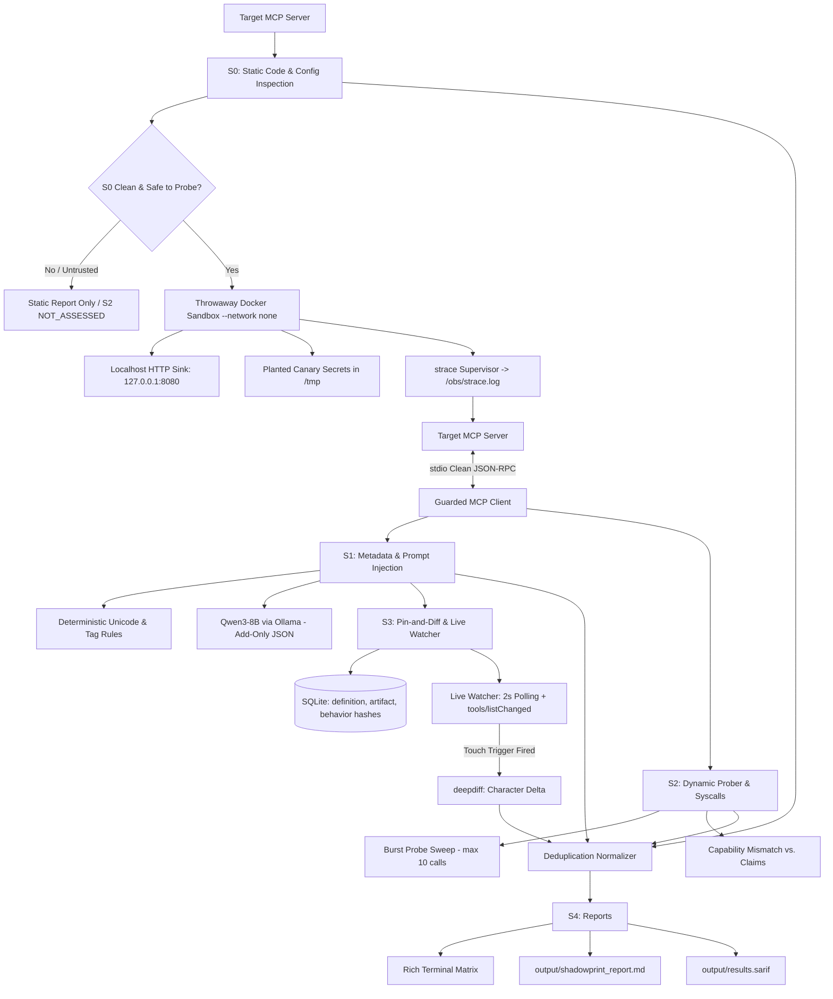

# Shadowprint — MCP Server Security Auditor

> *"Every server leaves a trace."*

Shadowprint is an evidence-first, 100% offline security auditor for **Model Context Protocol (MCP)** servers. It bridges the gap between what an MCP server claims to do, what its code implements, how it behaves at runtime inside an isolated container, and how its definitions drift over time:

$$\text{Claim} \longleftrightarrow \text{Code} \longleftrightarrow \text{Runtime} \longleftrightarrow \text{Drift}$$

---

## 👥 The Team & Work Division

* **Track:** Track 1: Open Weight AI & Open Source Tools
* **Team:** Qodex
* **Co-Builders:**
  * **Jasjyot Singh (Team Lead):** S0 Static Code Analysis, S1 Metadata & Prompt Injection Analysis, Deduplication Normalizer, Terminal & Markdown Reporting, CLI Orchestrator.
  * **Gaurang Udgirkar:** Docker Sandboxing, Guarded MCP Client, S2 Dynamic Kernel Syscall Probing, S3 SQLite 3-Layer Pinning & Live Watcher, SARIF Exporter.

---

## 🏗️ Architecture Overview



---

## 🚀 Quickstart

### Prerequisites
- Python 3.10+
- Docker Desktop (with WSL2 backend on Windows)
- Ollama with `qwen3:8b` (or `qwen3:4b`)

### Installation
```bash
# Clone the repository
git clone https://github.com/Gaurang774/Shadowprint.git
cd Shadowprint

# Install dependencies
pip install -r requirements.txt
pip install -e .
```

### Usage
```bash
# Run full audit (S0 -> S1 -> S2 -> S3 -> S4)
shadowprint audit ./fixtures/vulnerable_runner

# Run static & metadata only (skips container)
shadowprint audit --skip-dynamic ./fixtures/poisoned_weather

# Pin approved server fingerprint
shadowprint approve ./fixtures/clean_notes

# Live watch server for definition drift / rug-pulls
shadowprint watch ./fixtures/rugpull_suite
```

---

## 🎯 Benchmark Test Suite

| Fixture | Vulnerability / Planted Issue | Caught By |
|---|---|---|
| `fixtures/clean_notes` | Benign notes CRUD tool | Clean baseline (0 FP) |
| `fixtures/clean_fetch` | Benign fetch tool | Clean baseline (0 FP) |
| `fixtures/poisoned_weather` | Prompt injection in descriptions via Unicode TAGs | Engine S1 (Rules + Qwen3) |
| `fixtures/vulnerable_runner` | `shell=True` injection + hardcoded AWS secret | Engine S0 (Bandit + Gitleaks) |
| `fixtures/exfil_calculator` | Canary key theft (`/tmp/canary_creds.env`) + egress | Engine S2 (Dynamic Prober) |
| `fixtures/rugpull_suite` | Definition flips upon `/tmp/rugpull_trigger.flag` | Engine S3 (Live Watcher) |
| `fixtures/attack_the_auditor` | Hostile `#nosec` / `#nosemgrep` bypass attempts | S0/S1 Hardening (`TAMPER_ATTEMPT`) |

---

## 📄 License
Apache 2.0
